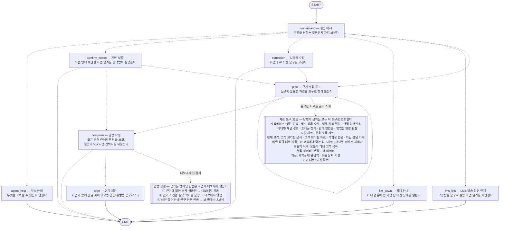

# 연금 에이전트

영업점 직원이 퇴직연금(IRP) 고객을 상담할 때 옆에 두고 묻는 대화형 에이전트다.
직원이 자연어로 물으면 행내 지식베이스, 지금 열려 있는 고객의 계좌 정보, 부점 고객 데이터를
근거로 답한다.

이 폴더(`src/`)만으로 설치·실행·배포가 된다. 이 문서 하나에 필요한 내용을 모두 적었다.

| 문서 | 내용 |
|---|---|
| 이 문서 | 하는 일 · 구조 · 설치 · 실행 · 배포 |
| `pension_agent/CLAUDE.md` | 대화 동작의 기준(있어야 할 동작과 알려진 차이) |
| `pension_agent/knowledge/CLAUDE.md` | 지식 카드가 갖춰야 할 구조 |
| `AUTHORING.md` | 지식·상품·전략 데이터를 추가하는 방법 |
| `.env.example` | 설정 항목 전체와 각 항목의 뜻 |

## 1. 하는 일

직원의 질문 하나를 한 턴으로 처리한다. 질문에 따라 아래 기능 중 필요한 것을 골라 쓴다.

| 기능 | 직원이 묻는 말의 예 | 고객 화면 필요 |
|---|---|---|
| 지식 질의응답 | 「세액공제 한도 얼마야?」 · 「계약이전 어떻게 처리해?」 · 「고객이 수수료 비싸다는데 뭐라고 하지?」 | 아니오 |
| 고객별 솔루션 | 「이 고객 브리핑 해줘」 · 「이 고객 왜 관리 대상이야?」 · 「뭘 안내할 수 있어?」 | 예 |
| 메인 브리핑(부점 데이터) | 「우리 부점 만기 30일 이내 고객 누구야?」 · 「다른 부점이랑 타겟 수 비교해줘」 | 아니오 |
| 오늘의 타겟 목록 | 「오늘 누구부터 봐야 해?」 | 아니오 |
| 쪽지 보내기 | 「지금까지 내용 정리해서 쪽지로 보내줘」 → 확인 후 발송 | 아니오 |
| 화면 연계 | 답변에 나온 단말 화면번호를 딥링크로 준다 | 아니오 |

**역할 분담.** 무엇을 조회할 수 있는지, 수치 계산, 답변 검사는 코드가 정한다. LLM 은 어떤
기능을 부를지 고르고 문장을 쓴다. 답변에 근거 밖의 숫자나 상품명이 들어 있으면 코드가 그
답변을 내보내지 않는다.

## 2. 폴더 구조

```
src/
├─ main.py                 HTTP 진입점(FastAPI). 행내 플랫폼이 부르는 곳
├─ Dockerfile              행내 배포 이미지
├─ requirements.txt        행내 배포 이미지와 같은 패키지 목록
├─ .env.example            설정 견본 — 복사해서 .env 로 쓴다
├─ AUTHORING.md            데이터 저작 방법
├─ pension_agent/          에이전트 패키지
│  ├─ graph.py             그래프 조립 · ask() — 한 턴의 진입 함수
│  ├─ state.py · routing.py · context_store.py · turn_trace.py · __main__.py(REPL)
│  ├─ nodes/               그래프 단계: 질문 이해 · 도구 고르기 · 답변 작성 · 되묻기 · 제안·확인
│  ├─ tools/               에이전트가 부르는 기능. __init__.py 의 TOOLS 가 전체 목록이다
│  │  ├─ kb_search/        지식베이스 검색(화법·수치·절차·화면·시황·상품 등)
│  │  ├─ customer_solution/  고객별 솔루션(고객 원장·타겟 판정·추천 계산·브리핑 문서)
│  │  ├─ branch_briefing/  메인 브리핑(부점 데이터 조회 — SQL 생성·검사·실행)
│  │  └─ general/          날짜 · 세액공제 계산 · 상담 이력 · 직전 답변
│  ├─ evidence/            근거 목록의 규약과 답변 검사
│  ├─ actions/             답변 뒤의 행위: 발송 화면 · 쪽지 초안 · 딥링크 · 추천 질문
│  ├─ prompts/             LLM 프롬프트 문장(쓰는 모듈과 같은 파일 이름)
│  ├─ knowledge/           지식 카드 적재 · 스키마 · 카드 데이터(data/) · 금리 소스(market/)
│  └─ common/              설정 · 환경변수 · 시계 · LLM 클라이언트 · MCP · 로깅
├─ scripts/                실행 스크립트 · 데이터 변환기 · 생성기
├─ tests/                  회귀 테스트(LLM 키 없이 돈다)
└─ runtime/session_data/   상담 이력 저장소(시연용 기록 포함)
```

폴더마다 `__init__.py` 머리말에 파일별 한 줄 설명이 있다. 층 사이의 임포트 방향은 한쪽이다 —
`common ← knowledge ← state ← evidence ← tools ← actions ← nodes ← graph`.
이 방향을 거스르는 임포트는 `tests/infra/s03_boundaries.py` 가 잡는다.

## 3. 설치

명령은 **전부 `src/` 에서** 실행한다. 그래야 `src/` 가 임포트 기준 폴더가 된다.

```bash
cd src
pip install -r requirements.txt       # Python 3.10 · fastapi · uvicorn · python-dotenv · langgraph==0.4.8
pip install anthropic openpyxl        # 사외 개발용(선택) — anthropic 프로바이더 · xlsx 변환기
```

**사외 PC 에서는 MCP 패키지 세 줄을 빼고 설치한다.** `python-mcp-sdk` 는 행내 Nexus 에만 있다.
빼도 나머지는 그대로 동작한다 — 쪽지와 행내 DB 조회만 «미연결»로 답한다.

```bash
grep -v -E '^(python-mcp-sdk|langchain-mcp-adapters|mcp)==' requirements.txt | pip install -r /dev/stdin
```

행내에서 공개 PyPI 가 막혀 있으면 Nexus 를 지정한다.

```bash
pip install -r requirements.txt \
  --index-url https://stg-nexus-genaihub.kbonecloud.com/repository/pypi/simple \
  --trusted-host stg-nexus-genaihub.kbonecloud.com
```

폴더를 복사해 올린 경우(Windows 를 거친 경우) 셸 스크립트의 줄끝 문자(CRLF)를 먼저 바꾼다:
`find . -name "*.sh" -exec sed -i 's/\r$//' {} + && chmod +x scripts/*.sh`

## 4. 설정 — `.env` 하나

```bash
cp .env.example .env
python -m pension_agent.common.env     # 어느 파일이 읽혔고 어느 LLM 프로바이더가 잡혔나
```

설정 파일은 `src/.env` 하나다. 행내 워크스페이스, 배포 이미지, 사외 PC 가 모두 같은 파일을 쓴다.
같은 이름의 실제 환경변수가 있으면 그 값이 파일보다 우선한다. `.env` 는 프로세스가 시작할 때
한 번만 읽으므로, 고쳤으면 서버를 다시 띄운다.

### LLM 프로바이더

| 프로바이더 | 쓰는 곳 | 필요한 값 |
|---|---|---|
| `genai` | 행내 GenAI 플랫폼(OpenAI 호환) | `LLM_BASE_URL` · `LLM_API_KEY` |
| `gemma` | 사외에서 행내와 같은 계열 모델로 점검 | `GEMINI_API_KEY` (모델 기본값 `gemma-4-31b-it`) |
| `anthropic` | 사외 테스트 | `ANTHROPIC_API_KEY` · `anthropic` 패키지 |

`LLM_PROVIDER` 로 고른다. 비우면 `LLM_BASE_URL` 이 있을 때 genai, 없고 `GEMINI_API_KEY` 가
있을 때 gemma, 둘 다 없으면 anthropic 이다.

행내 플랫폼은 분석계와 서빙계의 주소가 다르다. `LLM_BASE_URL_TRNN` · `LLM_BASE_URL_SERV`
(키도 `_TRNN` · `_SERV`)를 함께 두면 실행 단계(`ENV_PATH`)가 어느 쪽을 쓸지 정한다 —
워크스페이스는 분석계, Jenkins 배포는 서빙계다. 단계별 이름이 없으면 접미사 없는 이름을 읽는다.
**주의:** `LLM_BASE_URL_SERV` 만 채우고 `LLM_API_KEY_SERV` 를 비우면 서빙계 주소에 분석계 키가
실려 `HTTP 401 invalid subscription key` 가 난다. `/health` 의 `base_url_from` · `api_key_from` ·
`key_stage_mismatch` 가 어느 변수에서 읽었는지 보여준다.

## 5. 실행

### 명령줄

```bash
source scripts/cli.sh        # CA · CAD · CADR 별칭을 정의하고 사용법을 출력한다
```

| 별칭 | 명령 | 용도 |
|---|---|---|
| `$CA` | `python -m pension_agent` | 질문 한 턴 또는 대화(REPL) |
| `$CAD` | `python -m tests.debug` | 같은 것 + 단계별 기록(트레이스) |
| `$CADR` | `python -m tests.debug.reps` | 대표 질문 묶음을 차례로 실행 |

셋 다 HTTP 서버 없이 `graph.ask()` 를 직접 부른다.

```bash
$CA "세액공제 한도가 얼마야?"
$CA -c 198734-1205842 "이 고객 브리핑 해줘"           # -c: 열려 있는 고객의 id
$CA -c 198734-1205842 "투자성향 뭐야?" "만기 자금은?"  # 여러 턴을 이어서
$CA -e 3902172 "우리 부점 만기 30일 이내 고객 누구야?" # -e: 질문하는 직원의 사번
$CA -c 198734-1205842 -e 3902172 "이 내용 쪽지로 보내줘" "네"
python -m pension_agent.tools.customer_solution.situations   # 시연 고객 이름과 id 목록
```

- `-c` 가 없으면 고객 관련 질문에 «고객 화면을 먼저 열어주세요»로 답한다.
- `-e` 가 없으면 부점 데이터 조회와 쪽지 발송을 하지 않는다. 시연 사번 3902172 는 목업 DB 의
  여의도 부점 소속이다.

**처음 설치했으면 이 순서로 확인한다.** LLM 없이 도는 검사가 깨지면 키를 확인해도 소용없다.

```bash
python -m pension_agent.common.env    # «LLM 호출 가능 예»가 나와야 한다
python -m tests.test_api              # HTTP 입출력 규격
python -m tests.test_agent            # 통과하면 langgraph 그래프가 정상적으로 만들어진다
$CA "세액공제 한도가 얼마야?"
```

### HTTP API (행내 플랫폼이 부르는 진입점)

```bash
scripts/run_local.sh                                         # uvicorn main:app — :8000
scripts/test_local.sh "IRP 수수료 부담된다는데 뭐라고 답하죠?"   # /health 확인 후 /chat 한 턴
CUSTOMER_ID=198734-1205842 scripts/test_local.sh "이 고객 왜 관리 대상이야?"
RAW=1 scripts/test_local.sh "질문"                            # 응답 이벤트 JSON 을 그대로 출력
```

요청 키와 응답 이벤트(`progress` · `answer` · `sources` · `done` 등)의 규격은 `main.py` 머리말에
있다. 프론트·게이트웨이 쪽 설명서는 `client/README.md` 로 따로 배포한다.

### 디버그

```bash
$CAD --debug "세액공제 한도가 얼마야?"            # 답변 아래에 단계별 기록
$CAD --debug -c 198734-1205842                    # REPL — 턴마다 방금 턴의 기록만
$CAD --script tax_credit_asserts_wrong --debug    # 미리 만든 LLM 응답으로 재현(키 불필요)
$CAD --list                                       # 미리 만든 시나리오 목록
$CADR                                             # 검토 12케이스 + 요약표
$CADR demo --why                                  # 시연 대본 — 턴마다 무엇을 찾았는지
$CADR --help
```

| 옵션 | `$CAD` | `$CADR` |
|---|---|---|
| `--debug` | 답변 아래에 전체 기록 | — |
| `--why` | — | 턴마다 «무엇을 찾아봤나 → LLM 이 몇 자 썼나» |
| `--show-llm` | 검사에서 버려진 LLM 문장도 출력 | 같다 |
| `--brief` · `--time` · `--pause=N` · `--retry-down=N` | — | 요약표만 · 턴별 시간 · 턴 사이 대기 · LLM 실패 턴 재시도 |
| `--script N` · `--list` | 미리 만든 LLM 응답으로 실행 | — |

기록에는 단계 순서, LLM 호출 위치, 답변 검사 결과(`verify_texts` → `relations` → `span`)가
찍힌다. 앞 단계에서 걸리면 뒤 단계는 실행되지 않는다.

## 6. 한 턴의 흐름

<!-- generated:architecture:start — python -m scripts.render_architecture 가 갱신한다. 손으로 고치지 않는다 -->


실선은 고정된 흐름, 점선은 질문에 따라 갈리는 분기다. 자료 도구와 답변 점검 상자는
LangGraph 노드가 아니라 근거 수집·답변 작성 **안**에서 도는 것을 꺼내 그린 것이다 —
`get_graph()` 출력에 도구가 보이지 않는 이유가 그것이다. 어떤 도구가 있는지와 답변을
내보낼지는 코드가 정하고, 이번 질문에 무엇을 쓸지는 LLM 이 정한다(1절 «역할 분담»).
코드 대응: 도구 레지스트리 `tools.TOOLS` · 점검 `verify_texts`/`relations`/`span` ·
분기 `routing.py`.
<!-- generated:architecture:end -->

**질문 분류(`intent`).** `situation`(기본값 — 지식·고객 자료로 답하는 질문 전부) · `guide` ·
`agent_help` · `lms_link` · `correction` · `confirm_action` · `llm_down`. 목록 밖 값은 기본값으로
처리되므로 분류가 틀려도 계획 단계가 답한다. 값·절차·브리핑 질문에 전용 단계는 없다 — 전부
계획 단계가 도구를 골라 답한다.

**새 기능을 붙이는 방법은 도구 하나를 추가하는 것이다.** `tools/__init__.py` 의 `TOOLS` 에
`Tool(이름, 설명, 함수)` 를 넣는다. 계획 단계의 LLM 은 이 설명을 읽고 도구를 고르므로, 설명에
«어떤 질문이 이 도구로 와야 하는지»를 예문으로 적는다. 도구는 근거(`Evidence`), «못 찾음»(`None`),
«조회 실패»(`ToolFailure`) 셋 중 하나를 돌려준다.

| 조정값 | 위치 | 기본 | 뜻 |
|---|---|---|---|
| `MAX_STEPS` | `nodes/plan.py` | 4 | 한 턴에 도구를 부르는 횟수 상한 |
| `HISTORY_LIMIT` | `state.py` | 12 | 프롬프트에 싣는 최근 대화 턴 수 |
| `HISTORY_VERBATIM` / `HISTORY_OLD_CHARS` | `state.py` | 4 / 40 | 최근 4턴은 질문 원문, 그 앞은 40자까지 |
| `PITCH_TOP_K` | `tools/kb_search/pitch.py` | 3 | 프롬프트에 넣는 화법 카드 수 |
| `MIN_TOPICAL` | `knowledge/kb.py` | 0.5 | 문자열 유사도 검색의 관련도 하한 |

## 7. 고객별 솔루션 (`tools/customer_solution/`)

지금 열려 있는 고객 한 명의 현황, 관리 대상(타겟)으로 선정된 이유, 안내할 수 있는 상품을
계산한다.

**전체 브리핑 문서**(`briefing` 도구, `solution.py`)는 두 부분이다.

| 부분 | 내용 | 만드는 쪽 |
|---|---|---|
| 사실 | 태그 · 고객 정보 표 · IRP 계좌 현황 표 | 코드 — 계산 결과를 그대로 옮긴다 |
| AI 분석 | 최근 금융상황 · 이번 상담에서 확인할 점 · 왜 지금 · 고객과 확인할 것 | LLM 1회 |

AI 분석의 문장 중 계산 결과에 없는 숫자·날짜가 든 문장은 코드가 버린다. 같은 고객·같은 날의
AI 분석은 프로세스 안에서 한 번만 만든다. 그래서 브리핑을 본 뒤 이어서 묻는 질문(`customer`
도구)이 같은 문장을 근거로 쓴다. 브리핑 문서는 답변 작성 단계를 거치지 않고 그대로 답이 된다.
값 하나를 묻는 질문(「수익률 얼마야?」)은 LLM 으로 브리핑을 만들지 않는다.

**계산 단계(LLM 없음).**

| 파일 | 하는 일 |
|---|---|
| `customer.py` | 고객 원장(`customers.json`) → `Profile`. 원장 기준일 `AS_OF` 와 상담 시점 `today()` 를 구분한다 |
| `target_list.py` | 타겟 14종 판정. 기준표는 `targets.json`(기획자 확인 룰베이스의 변환본) |
| `situations.py` | 고객 상태 → 문제상황 매칭 |
| `engine/` | 추천 계산 — 요건 판정 · 자금 배분 · 적합성 게이트 · 기대효과 · 우선순위 |
| `support/` | 고객 상태에 맞는 화법 · 예상 반론 · 참고자료 · 안내 콘텐츠 |
| `guard.py` | 고객 요건에 걸린 «하지 말 것» 카드 |

**안전장치.** 적합성 게이트는 위험등급 · 최소금액 · 거래채널 · 위험자산 한도를 대조하고, 통과한
상품이 없으면 그 전략을 뺀다. 자금 배분은 두 전략이 같은 돈을 겹쳐 쓰지 못하게 한다.

**데이터(`data/*.json`) — 코드를 고치지 않고 JSON 만 채워 늘린다.** 저작 절차는 `AUTHORING.md`.

| 파일 | 내용 |
|---|---|
| `strategies.json` · `system_strategies.json` | 전략 — 요건 · 문장 조각 · 근거 · 시급성 · 출처 |
| `products.json` | 상품 — 위험등급 · 최소금액 · 비대면 가능 여부 · 위험자산 산입 |
| `baselines.json` | 기대효과 비교 기준값 |
| `capabilities.json` | 시스템 기능 지원 여부 |
| `assets.json` | 고객에게 보낼 세미나·이벤트와 발송 문구 |
| `portfolios.json` · `top_holdings.json` | 추천 포트폴리오 후보 · 수익률 상위 고객 상품 사례(시연값) |
| `outreach_golden.json` | 안내 콘텐츠 선정의 평가용 정답. LLM 입력에 넣지 않는다 |

고객 원장과 타겟 기준표는 생성물이다. 고칠 값은 원본(xlsx)에 넣고 다시 만든다.

```bash
python -m scripts.import_customers     # 더미 고객 xlsx + scripts/demo_cases.json → customers.json
python -m scripts.import_targets       # 타겟 룰베이스 xlsx → targets.json
python -m pension_agent.tools.customer_solution.engine   # 전략·상품 정의 검증(ERROR 0건)
```

## 8. 메인 브리핑 — 부점 데이터 조회 (`tools/branch_briefing/`)

직원이 자기 부점의 IRP 고객 데이터를 조건으로 묻는다(「디폴트옵션 미설정 몇 명이야?」).

```
질문 → [LLM] SELECT 문 한 개 → [코드] 검사 → [코드] 실행 → 결과 표 → [LLM] 답변
```

| 단계 | 파일 | 하는 일 |
|---|---|---|
| 볼 수 있는 것 | `views.py` | LLM 에게 보여주는 유일한 스키마. 고정 뷰 두 개 — `v_irp_customer`(우리 부점 고객, 한 명당 한 행) · `v_branch_summary`(부점별 집계) |
| 검사 | `check.py` | SELECT 한 문장만 · 세미콜론·주석·WITH·쓰기 명령 금지 · 고정 뷰만 조회 · 시스템 객체 금지 |
| 실행 | `run.py` | 고정 뷰 SQL 을 `WITH` 로 앞에 붙인다(DB 에 뷰를 만들지 않는다). 부점코드는 직원 사번으로 조회한 값을 코드가 넣는다. 최대 100행(Sybase 는 `SELECT TOP`) |
| 재시도 | `tool.py` | 검사나 실행에서 걸리면 이유를 LLM 에게 돌려주고 최대 2번 다시 쓰게 한다 |
| 고정 뷰 SQL | `sql/sqlite/` · `sql/sybase/` | 사람이 쓴다. 조인과 코드값 풀이가 여기 있다 |

- **부점 범위는 코드가 정한다.** LLM 이 SQL 에 다른 부점을 적어도 `v_irp_customer` 에는 질문한
  직원의 부점 고객만 들어 있다. 다른 부점은 `v_branch_summary` 의 집계로만 볼 수 있다.
- **사번은 요청이 넘긴 값만 쓴다.** 사번이 없거나 부점을 찾지 못하면 조회하지 않는다.
- 실행한 SQL 은 근거의 출처 정보에 남는다.

DB 는 `BRANCH_DB` 로 고른다.

| 값 | DB |
|---|---|
| `demo` (기본) | 행외 목업 DB(sqlite 메모리, `demo_db.py`) — 부점 4곳 · 고객 300명. 전부 시연값이다 |
| `sybase` | 행내 Sybase IQ 를 MCP 도구 `sybaseiq_query` 로 조회한다(`common/mcp/sybase.py`) |
| `off` | 조회하지 않는다. 표에 없는 값도 `off` 로 본다 |

**행내로 옮길 때 할 일.**
1. `sql/sybase/` 의 세 파일(`my_branch.sql` 사번→부점 · `v_irp_customer.sql` · `v_branch_summary.sql`)을
   실제 테이블로 작성한다. 결과 컬럼 이름과 뜻은 `views.py` 와 같아야 한다. 작성 전에는 «DB 미연결»로 답한다.
2. `.env` 에 `BRANCH_DB=sybase`, `MCP_SERVERS=workb,sybase`, `MCP_CONN_ID` 를 넣는다.
3. `sybaseiq_query` 의 SQL 인자 이름과 응답 형식을 확인한다. 다르면 `MCP_SYBASE_TOOL` ·
   `MCP_SYBASE_QUERY_ARG` 로 바꾼다.

## 9. 지식 데이터 (`knowledge/`)

지식 카드는 `pension_agent/knowledge/data/kb_*.json` 이다. 행원들이 정리한 지식베이스 원문(이
저장소에서는 `src/` 바깥의 `01_`~`09_` 폴더)을 변환기가 카드로 만든 **생성물**이므로 손으로 고치지
않는다.

모든 데이터 파일은 같은 형태를 쓴다: `{ meta:{kind,…}, records:[{id, kind, fields, source?, refs?}] }`.
종류(`pitch` · `fact` · `procedure` · `product` …)는 `knowledge/kinds.json` 에 선언한다. 새 종류는
이 파일에 한 항목을 더하면 검증·적재가 코드 수정 없이 붙는다. 적재는 `knowledge.shared_store()`
한 곳에서만 한다.

```bash
python -m pension_agent.knowledge.schema kinds                     # 등록된 종류
python -m pension_agent.knowledge.schema validate pension_agent    # 전체 데이터 검증 — ERROR 0건 유지
python -m pension_agent.knowledge.kb                               # 지식베이스 점검 리포트
```

원문 폴더가 함께 있는 저장소에서만 카드를 다시 만들 수 있다.

```bash
python -m scripts.kb_build.build_kb              # 원문 → 초안 생성 + 변환 리포트
python -m scripts.kb_build.build_kb --activate   # 검토 후 활성화
```

**금리 소스(`knowledge/market/`).** `current()` 가 금리·시황 사실을 돌려준다. 지금은
`rates_demo.json`(시연용 자리표시자)을 그대로 돌려준다. 원천 API 가 정해지면 `current()` 의 본문만
바꾼다 — 반환 형태(`facts` · `briefs` · `as_of` · `sources`)는 유지한다. 화법 카드의 금리 수치를
현재값으로 바꿔 보여줄 때 쓴다(원문 인용은 고치지 않는다).

## 10. 테스트

전부 LLM 키 없이 돈다. 코드를 고친 뒤 모두 통과하는지 확인한다.

```bash
python -m tests.test_engine               # 추천 엔진 계산
python -m tests.test_support              # 화법·반론·참고자료·안내 콘텐츠 선정
python -m tests.test_customer_solution    # 브리핑 문서 — LLM 1회 · 검사 · 실패 처리
python -m tests.test_branch               # 부점 데이터 조회 — SQL 검사 · 부점 범위 · 행 수 상한
python -m tests.test_agent                # 분류 · 도구 루프 · 답변 검사 · 쪽지 (본문은 tests/agent/)
python -m tests.test_infra                # 공용 기반 · 임포트 방향 · 429 호출 제한
python -m tests.test_api                  # HTTP 입출력 규격
python -m tests.debug.test_trace          # 단계 기록
python -m scripts.kb_build.test_paths     # 원문 경로 실재(원문 폴더가 있을 때)
python -m pension_agent.knowledge.schema validate pension_agent
```

생성물을 다시 만드는 명령:

```bash
python -m scripts.render_architecture     # 이 문서 6절의 그래프 그림
python -m scripts.demo_status             # 시연값 현황 리포트(원문 저장소의 docs/DEMO_STATUS.md)
```

## 11. 문제 해결

| 증상 | 원인 | 조치 |
|---|---|---|
| `/bin/bash^M: bad interpreter` | 줄끝 문자(CRLF) | 3절의 `sed` 명령 |
| `프로바이더 anthropic` 이 잡힘 | `.env` 가 안 읽혔거나 LLM 주소가 비어 있음 | `python -m pension_agent.common.env` 로 읽힌 파일 확인 |
| `Name or service not known` | DNS | `getent hosts <호스트>` 로 확인 |
| `HTTP 404` | 주소 또는 모델 이름 | 오류에 응답 본문과 호출 URL 이 찍힌다. 「Resource not found」면 `LLM_BASE_URL`, 「model_not_found」면 `LLM_MODEL` |
| `HTTP 401 invalid subscription key` | 단계(분석계/서빙계)와 키가 어긋남 | 4절 «주의» |
| `HTTP 429` | 호출 횟수 제한 | `.env` 의 호출 간격(`LLM_MIN_INTERVAL_SEC`)을 늘리거나 동시 호출(`LLM_MAX_CONCURRENCY`)을 줄인다. STG 는 분당 10회라 `1` · `6.5` 로 둔다 |
| `HTTP 400 민감정보 감지됨` | 게이트웨이의 개인정보 필터 | 응답의 `rule_name` 으로 걸린 규칙을 본다. 프롬프트에 그 형태의 값을 싣지 않도록 고친다(`common/privacy.py` 머리말) |
| 부점 데이터 질문에 «조회하지 못했다» | 사번이 없음 · 부점을 못 찾음 · `BRANCH_DB=off` · Sybase SQL 미작성 | 요청에 `employee_id` 가 있는지, 8절 설정을 확인 |

## 12. 배포

```bash
docker build -f Dockerfile -t pension-agent .    # 내부망(STG 기준 · PRD 는 주석 줄로 교체)
```

이미지에 들어가는 설정 파일은 `.env` 하나다 — 없으면 빌드가 실패한다. 배포용 `.env` 를 따로
만들지 않는다. 분석계/서빙계 중 어느 주소를 쓸지는 Jenkins 가 넣는 `ENV_PATH` 가 정한다
(`Dockerfile` 주석). 외부망용 Dockerfile 과 개발용 패키지 목록은 저장소에 넣지 않는다.

## 13. 관측 (Langfuse)

`.env` 에 `LANGFUSE_PUBLIC_KEY` · `LANGFUSE_SECRET_KEY` 를 넣으면 켜지고, 없으면 꺼진다.
한 턴이 트레이스 하나로 묶인다. 프롬프트에 고객 정보가 실리므로 반드시 행내 호스트를 쓴다.
설정 항목은 `pension_agent/common/observability/__init__.py` 머리말.

```bash
python -m pension_agent.common.observability    # 설정을 출력하고 이벤트 한 건을 실제로 보낸다
```

## 14. 행내 시스템 연동 (MCP)

행내 시스템은 MCP 로 붙는다. 지금 쓰는 것은 둘이다 — WorkB 쪽지 발송(`common/mcp/workb.py`),
Sybase IQ 조회(`common/mcp/sybase.py`, 8절).

```bash
MCP_SERVER_URL=...       # 게이트웨이 주소(분석계·서빙계가 다르면 _TRNN · _SERV 두 벌)
MCP_USER_ID=...          # 발급받은 클라이언트 id
MCP_SECRET_KEY=...       # 발급받은 시크릿 키
MCP_SERVERS=workb        # 붙을 서버 목록. 부점 DB 를 쓰면 workb,sybase
MCP_CONN_ID=...          # sybase 서버를 쓸 때만
WORKB_EMP_NO=3902172     # 쪽지: 요청에 사번이 없을 때 쓰는 값. 부점 DB 조회에는 쓰지 않는다
```

```bash
python -m pension_agent.common.mcp      # 설정 · 패키지 · 서버 · 도구 목록을 한 화면에
curl -s localhost:8000/health | jq .mcp
```

- 설정이나 행내 패키지가 하나라도 없으면 보내지 않고 «미연결»이라고 답한다. `/health` 의
  `mcp` 칸이 `configured`(설정)와 `packages`(패키지)를 나눠 보여준다 — 설정이 없으면 `.env` 를
  채우고, 패키지가 없으면 이미지를 다시 만든다.
- **사번.** 요청의 `input_value.employee_id` 가 먼저이고, 없으면 `x_client_user` 가 7자리 숫자로
  시작할 때 그 앞 7자리를 쓴다(`3902172-550e8400-…`). 요청 로그의 `사번=` 이 `-` 면 사번을 읽지
  못한 것이다.
- **쪽지 받는 사람**은 기본이 본인이고, 직원이 사번이나 이름을 적었을 때만 다른 직원이다.
- **발송은 다시 시도하지 않는다.** 시간 초과는 «안 나갔다»가 아니라 «나갔는지 모른다»이므로,
  다시 보내면 같은 쪽지가 두 통 갈 수 있다. 연결 단계(토큰·도구 목록)의 실패만 다시 시도한다.
- 다른 행내 기능을 붙이려면 세 곳을 본다 — 서버 표(`common/mcp/servers.py`), 연결과 호출
  (`common/mcp/client.py`, 고치지 않는다), 도구 어댑터(`workb.py` 같은 파일 하나).

## 15. 보안

- 지식 카드(`knowledge/data/`)와 상품·전략 데이터(`tools/customer_solution/data/`)에는 행내
  영업전략과 상품조건이 들어 있다. 대외비로 다룬다.
- `.env` 는 저장소에 넣지 않는다(`.env.example` 만 넣는다).
- 고객 식별번호는 LLM 프롬프트와 응답에 싣지 않는다. 행내 게이트웨이의 개인정보 필터가 그
  형태를 주민등록번호로 보고 요청을 막는다.
